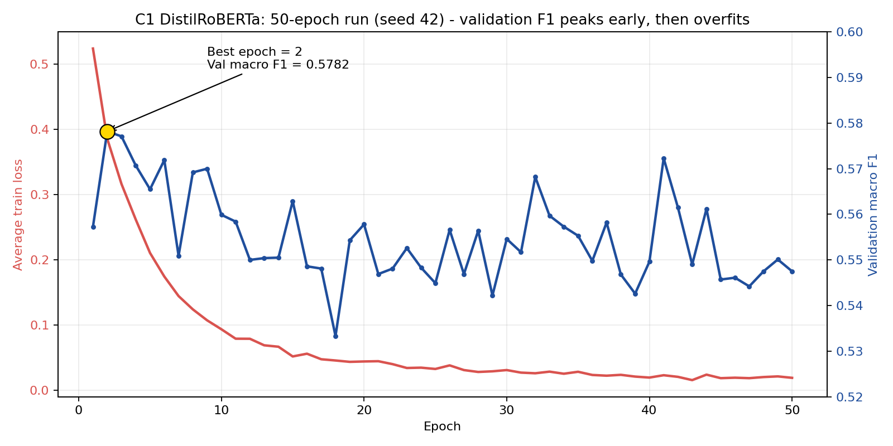

# Component 1: Student Affective State Detection (`c1-affective`)

**Project:** J26-IT-349, AI-Driven Early Warning System for Student Dropout in Higher Education
**Student:** Asipath T.M.N.V (IT23145870), B.Sc. (Hons) in Information Technology, SLIIT
**Supervisor:** Dr. Junius Anjana | **Co-supervisor:** Ms. Poorna Panduwawala

---

## 1. What C1 does

Component 1 reads the text students write in the LMS (forum posts, chat messages, journal entries), detects **academic distress**, and turns it into a weekly affective profile per student. The profile is delivered as a contract-valid JSON record that Component 2 (behavioural trajectory) and Component 3 (dropout risk prediction) use as an input.

| | |
|---|---|
| **Input** | Pseudonymised, consent-filtered, PII-scrubbed student messages from `GET /api/v1/export/messages` |
| **Output** | Per student, course and week: five emotion scores, a stress label, a confidence value, a message count and the top words behind the decision (`AffectiveWeeklyVector`) |
| **Model** | Fine-tuned `distilroberta-base`, multi-label, five independent sigmoid outputs, per-class decision thresholds |
| **Final test result** | Macro F1 **0.5648**, macro ROC-AUC **0.9394** on the public proxy test set |

### Built versus planned

| Part | Status |
| --- | --- |
| Taxonomy, labelling guide, dataset mapping and leakage removal | Done |
| Baselines (TF-IDF, VADER) and main model, trained on a Colab GPU and evaluated | Done |
| Explainability (leave-one-word-out occlusion) | Done |
| Weekly vector validated against `contracts/v1/AffectiveWeeklyVector.json` | Done (dry run) |
| Streamlit demo with a live feed from the LMS export API | Done |
| Weekly aggregation service and `POST /api/v1/ingest/affective` wrapper | **Planned** |
| Domain adaptation on student-style text and a human-written `test_real.csv` | **Planned** |
| Comparison with other transformer encoders | **Planned** |

---

## 2. Architecture and data flow

```text
LMS database (MongoDB)
   |  consent filter + PII scrubbing + pseudonym PID (platform side)
   v
GET /api/v1/export/messages   (header X-Component-Key)
   |
   v
src/lms_client.fetch_messages()
   |
   v
tokenizer (max 64 tokens) -> DistilRoBERTa -> sigmoid -> 5 scores
   |
   v
per-class thresholds (models/thresholds.json) -> label or "none"
   |
   +--> leave-one-word-out occlusion -> top driver words
   |
   v
mean score per student and week -> AffectiveWeeklyVector
   |
   v
jsonschema validation against contracts/v1/AffectiveWeeklyVector.json
   |
   v
POST /api/v1/ingest/affective  (planned)  ->  C2 / C3
```

---

## 3. Distress taxonomy (5 classes)

| Class | Meaning | Example |
|---|---|---|
| `exam_anxiety` | Fear or worry about exams or deadlines | "I'm terrified I'll fail the exam." |
| `conceptual_confusion` | Not understanding course content | "I still don't get how recursion works." |
| `academic_helplessness` | Feeling unable to succeed whatever they do | "There's no point, I can't do this course." |
| `course_frustration` | Anger or irritation with the course | "This assignment is badly explained." |
| `motivation_erosion` | Loss of interest or drive | "I've stopped caring about this module." |

The task is **multi-label**: one message can show several classes at once. A message that exceeds no threshold gets the label `none`. Labelling rules and more examples are in `docs/taxonomy.md` and `docs/annotation_guide.md`.

---

## 4. Folder map

```text
components/Nidu-c1-affective/
|-- data/
|   |-- raw/             original datasets (git-ignored)
|   |-- interim/         cleaned and mapped data, domain probe set (git-ignored)
|   `-- processed/       train.csv, val.csv, test_proxy.csv (git-ignored)
|-- demo/
|   `-- app.py           Streamlit demo (two tabs)
|-- docs/                taxonomy.md, annotation_guide.md
|-- models/              checkpoint-best and thresholds.json (git-ignored)
|-- notebooks/           Colab training notebook (colab_train.ipynb)
|-- reports/
|   |-- figures/         training curve, per-class chart, confusion matrix
|   `-- metrics/         evaluation JSON (baselines, final model, 50-epoch run)
|-- src/
|   |-- train.py         training loop, threshold tuning, final evaluation
|   |-- evaluation.py    macro F1, per-class metrics, AUC, class list
|   |-- probe_eval.py    domain probe evaluation
|   |-- lms_client.py    client for the LMS export API
|   |-- label_map.yaml   public-dataset labels mapped to the 5 classes
|   `-- data/            make_domain_template.py, split_reviewed.py
|-- tests/               unit tests
|-- .streamlit/          Streamlit configuration
|-- requirements.txt, requirements-lock.txt, pytest.ini
|-- .env.example
`-- README.md
```

---

## 5. Data and labels

**Why proxy data.** No labelled corpus of student distress text exists, and real student messages cannot be collected before consent and ethics approval. C1 is therefore trained on public emotion datasets whose labels are mapped to the five classes (`src/label_map.yaml`). All test scores in this README are on that **proxy** test set.

| Dataset | Use | Notes |
|---|---|---|
| **GoEmotions** (Reddit comments, 28 emotions) | Main training source (41,813 training samples) | Mapped to the 5 classes; unrelated emotions are ignored. A weak proxy, not educational text. |
| **4-class emotion dataset** (`eng_dataset.csv`, tweets) | Second training source (5,471 training samples) | Mostly tweets; not the original ISEAR. Supports only some of the 5 classes. |
| **Domain probe set** (self-built) | Evaluation only, never used for training | 140 education-style sentences, **AI-drafted**, to check domain transfer. |
| **OULAD** | Not used by C1 | Click data only; used by other components. |
| **LMS messages** | Inference and demo only | Used only with student consent, after `scrub_text()` removes personal data. |

**Splits** (leakage and duplicates removed during preparation):

| File | Samples |
|---|---|
| `train.csv` | 47,284 |
| `val.csv` | 5,943 |
| `test_proxy.csv` | 5,956 |

**Class imbalance.** Positive class weights are computed from the training set and clipped at 10.0: `[10.0, 10.0, 10.0, 5.86, 10.0]` in class order. Five classes are rare relative to the negatives, so unweighted training would favour "none".

`test_real.csv` is planned as a separate, human-written benchmark of authentic LMS communication. It will be strictly held out and never mixed into the files above.

---

## 6. Model and training

### Design decisions

| Decision | Reason |
|---|---|
| `distilroberta-base` (6 transformer layers, about 82M parameters) | Understands context, which TF-IDF cannot, yet is light enough to run on CPU inside an LMS deployment without a GPU server. |
| 5 independent **sigmoid** outputs, not softmax | A message can show several distress types at once. |
| **Per-class thresholds** tuned on the validation set | Classes differ in how confident the model is and how costly a false alarm is. |
| `BCEWithLogitsLoss` with positive class weights | Handles class imbalance without discarding data. |
| **Leave-one-word-out occlusion** instead of SHAP | Model-agnostic, no extra dependency, and fast: one batched forward pass per message. |
| Test set used once, at the end | Thresholds and the checkpoint are chosen on validation data only, so the test score is not tuned. |

### Settings

| | |
|---|---|
| Base model | `distilroberta-base` |
| Max sequence length | 64 tokens (longer text is truncated) |
| Batch size / learning rate / seed | 32 / 2e-5 / 42 |
| Loss | `BCEWithLogitsLoss` with clipped positive class weights |
| Threshold search | Grid 0.10 to 0.90 per class, after every epoch, maximising validation F1 |
| Checkpoint selection | Best validation **macro F1** |
| Hardware | Training on Google Colab, Tesla T4 GPU (about 5 minutes per epoch); inference and demo on CPU |

### Training environment

Fine-tuning on a laptop CPU is too slow, so training ran on **Google Colab (T4 GPU)** with code and data on Google Drive. The saved checkpoint was reloaded on CPU to confirm that the metrics reproduce. The notebook is `notebooks/colab_train.ipynb`.

```bash
python -m src.train --epochs 50 --batch-size 32 --lr 2e-5 --seed 42 --run-name epochs50
```

A run with `--run-name` writes to its own folder and to `reports/metrics/<run-name>.json`, so it cannot overwrite earlier results. `--max-samples` runs a quick smoke test (used before the long run).

---

## 7. Explainability and the weekly vector

**Occlusion.** For the predicted class (or the highest-scoring class when none exceeds its threshold), each word is removed in turn and the message is scored again. The drop in that class probability is the word's importance. Words with a drop above 0.005 become `top_drivers`, with the drop as `weight`. The demo highlights them in the text.

**Weekly aggregation (dry run in the demo).** For each student PID the demo takes the mean score per class over that student's messages. The `stress_label` is the first class whose mean score exceeds its threshold (else `none`), and `confidence` is the highest mean score. The record is then validated with `jsonschema`.

---

## 8. Results

All numbers are on the **public proxy test set** (`test_proxy.csv`, 5,956 samples) and are read from `reports/metrics/epochs50.json`.

### 8.1 Final model (best checkpoint: epoch 2 of a 50-epoch run)

| Class | Threshold | Precision | Recall | F1 | AUC |
|---|---|---|---|---|---|
| exam_anxiety | 0.90 | 0.6962 | 0.8019 | 0.7453 | 0.9789 |
| conceptual_confusion | 0.70 | 0.3694 | 0.5359 | 0.4373 | 0.9568 |
| academic_helplessness | 0.90 | 0.6657 | 0.7476 | 0.7043 | 0.9654 |
| course_frustration | 0.75 | 0.5788 | 0.6842 | 0.6271 | 0.9085 |
| motivation_erosion | 0.50 | 0.2281 | 0.4834 | 0.3100 | 0.8872 |
| **Macro** | | **0.5076** | **0.6506** | **0.5648** | **0.9394** |

By source: `goemotions_proxy` macro F1 0.4985, `emotion4_proxy` macro F1 0.5147.

AUC is above 0.88 for every class, so the model separates the classes well; the lower F1 comes from precision on the rare classes at the chosen thresholds. Recall is higher than precision by design, because for an early-warning tool a missed student costs more than a false alarm that a counsellor can dismiss.




### 8.2 Model comparison (macro F1, test)

| Model | Training data | Macro F1 |
|---|---|---|
| **DistilRoBERTa (final)** | GoEmotions + emotion-4 | **0.5648** |
| TF-IDF baseline | GoEmotions + emotion-4 | 0.4721 |
| DistilRoBERTa (ablation) | GoEmotions only | 0.4557 |
| TF-IDF (ablation) | GoEmotions only | 0.3694 |
| VADER | Generic sentiment lexicon | Cannot separate the 5 classes; shown side by side in the demo |

DistilRoBERTa beats the classical baseline in both settings, and adding the second data source raises macro F1 from 0.4557 to 0.5648. Other transformer encoders (for example DistilBERT, BERT-base, MiniLM) have **not** been compared yet (Section 14).

### 8.3 Training behaviour (50-epoch convergence run)

| Epoch | Train loss | Validation macro F1 |
|---|---|---|
| 1 | 0.5237 | 0.5573 |
| **2 (best)** | 0.3854 | **0.5782** |
| 3 | 0.3159 | 0.5771 |
| 5 | 0.2102 | 0.5655 |
| 10 | 0.0932 | 0.5599 |
| 20 | 0.0438 | 0.5578 |
| 30 | 0.0306 | 0.5546 |
| 40 | 0.0191 | 0.5496 |
| 50 | 0.0187 | 0.5475 |

Training loss keeps falling while validation macro F1 peaks at epoch 2 and then declines: the model overfits. Best-checkpoint selection on validation F1 therefore keeps epoch 2. An earlier 3-epoch run selected the same epoch and gave the same test result (macro F1 0.5648), which confirms reproducibility. In later epochs the tuned thresholds also become unstable (for example `exam_anxiety` moves between 0.10 and 0.90 from epoch to epoch), another sign that longer training does not help.


### 8.4 Domain probe (education-style text)

The 140-sentence probe set (AI-drafted, 105 positive and 35 neutral sentences) checks how the proxy-trained model behaves on student-style language. Overall recall was 43 of 105 positive sentences (41%) with 50 false alarms. Per-class recall: `exam_anxiety` 12/15, `conceptual_confusion` 13/30, `academic_helplessness` 1/15, `course_frustration` 6/15, `motivation_erosion` 11/30.

This shows a **domain gap**. `academic_helplessness` scores well on the proxy test set (F1 0.7043) but poorly on student-style text, because its proxy labels come from general emotions. Closing this gap is the main next step.

---

## 9. Requirements coverage

### Functional

| ID | Requirement | Status |
|---|---|---|
| FR1 | Detect five academic distress states in student text, several at once | Done |
| FR2 | Apply a tuned decision threshold per class and return `none` when none is exceeded | Done |
| FR3 | Explain each prediction by highlighting the words that drove it | Done |
| FR4 | Read only consented, scrubbed, pseudonymised messages through the platform API | Done |
| FR5 | Build a weekly affective vector per student that passes the contract schema | Done (dry run) |
| FR6 | Deliver the vector to the platform for C2 and C3 | Planned |
| FR7 | Let staff inspect results in a demo interface, including live LMS data | Done |

### Non-functional

| Area | How it is met |
|---|---|
| Privacy | Consent filter, PII scrubbing and pseudonym IDs on the platform side; no direct database access from C1 |
| Explainability | Word-level occlusion on every prediction |
| Reproducibility | Fixed seed, separate run folders, metrics saved as JSON, checkpoint re-evaluated on CPU |
| Deployability | Inference runs on CPU; the model is a 6-layer transformer |
| Interoperability | Output validated against a versioned JSON schema in `contracts/v1/` |
| Maintainability | Unit tests, documented label mapping, pinned requirements |

---

## 10. Platform integration

The authoritative schema is in `contracts/v1/` and `contracts/CONTRACT.md`. Never edit those files from this component. `scripts/send_sample_ingest.py` is a working example.

- **Read:** `GET /api/v1/export/messages` with header `X-Component-Key`. The platform returns only students with an active, accepted consent record for the current consent notice.
- **Write (planned):** `POST /api/v1/ingest/affective` with header `X-Component-Key`.
- **Authentication:** requests need a valid component key; if `COMPONENT_API_KEYS` is not configured on the backend, export and ingest endpoints return HTTP 503.

Example record (the contract defines the exact fields):

```json
{
  "pid": "STU_xxxxxxxx",
  "course_id": "CS101",
  "week_index": 2,
  "emotion_scores": {
    "exam_anxiety": 0.85,
    "conceptual_confusion": 0.10,
    "academic_helplessness": 0.02,
    "course_frustration": 0.02,
    "motivation_erosion": 0.01
  },
  "stress_label": "exam_anxiety",
  "confidence": 0.92,
  "message_count": 5,
  "top_drivers": [{"token_or_marker": "struggling", "weight": 0.78}]
}
```

`pid` is a pseudonymised id (`STU_` plus 8 hex characters). `week_index` is 0-based.

---

## 11. Interactive demo

```powershell
cd components\Nidu-c1-affective
.venv\Scripts\activate
streamlit run demo\app.py
```

The app opens at `http://localhost:8501` (Streamlit uses the next free port if that one is busy).

**Tab 1: Interactive Text Analysis**
1. Type a message or pick one of six examples (one per class plus a neutral one).
2. Predicted distress state and five score bars with their tuned thresholds.
3. Word-occlusion highlighting and the top driver tokens.
4. Weekly record preview with a **Contract Check** against `contracts/v1/AffectiveWeeklyVector.json`. The raw JSON sits in a collapsed *Technical view* panel.
5. Side panel: VADER generic sentiment, to show why a five-class model is needed.

**Tab 2: Live from LMS (Export Feed)**
- Needs `C1_COMPONENT_KEY` (environment variable, or entered in the app). `LMS_BASE_URL` defaults to `http://localhost:8000`.
- Fetches up to 500 scrubbed messages, newest first, with filters for student PID, source type (forum, journal, chat) and distress alerts.
- Predicts every message, then builds an aggregated weekly dry-run record per student with score bars and the collapsed JSON payload.
- On the seeded demo batch of 500 messages the model flagged 4 as distress and 496 as neutral.

### Probe evaluation

```powershell
python src/probe_eval.py --input data/interim/domain_reviewed_DRAFT.csv.csv
```

---

## 12. Risks and mitigation

| Risk | Mitigation |
|---|---|
| Proxy training data differs from real student text | Domain probe set to measure the gap; domain adaptation and a human-written `test_real.csv` planned |
| Overfitting on long training | Best-checkpoint selection on validation macro F1; 50-epoch curve documented |
| Class imbalance | Positive class weights and per-class thresholds |
| False alarms or missed students | Output is decision support for counsellors; thresholds favour recall; word highlights let staff check the reason |
| Leaking student identity | Pseudonym IDs, scrubbing and consent filtering on the platform; no direct database access |
| Overwriting results during experiments | Separate `--run-name` folders, backups before long runs, metrics stored as JSON |
| GPU dependency for training | Training on Colab; inference on CPU |

---

## 13. Known limitations

- The model is trained on **public proxy data**, not real student text. Every score in Section 8 is on a proxy test set and will not transfer one-to-one to real LMS messages.
- The domain probe set is small and AI-drafted; `academic_helplessness` performs poorly on it.
- `motivation_erosion` and `conceptual_confusion` are the weakest classes on the test set.
- Two of the five tuned thresholds (`exam_anxiety`, `academic_helplessness`) sit at the upper edge of the search grid (0.90).
- The demo's stress label is the first class, in taxonomy order, that exceeds its threshold, not the highest-scoring class.
- Messages are truncated at 64 tokens.
- The weekly aggregation and ingest wrapper are not yet implemented; the demo builds the record as a dry run only.
- C1 output is **decision support for counsellors**, not an automatic judgement of a student.

---

## 14. Next steps

1. Implement weekly aggregation and the ingest wrapper so C1 output reaches C2 and C3 through the contract.
2. Fine-tune and evaluate on student-style data, with a held-out human-written `test_real.csv`.
3. Compare further encoders (DistilBERT, BERT-base, MiniLM) against the current model and report inference cost as well as F1.
4. Revisit threshold selection (wider grid or cross-validated thresholds) and the choice of stress label.

---

## 15. How to run

```powershell
cd components\Nidu-c1-affective
python -m venv .venv
.venv\Scripts\activate
pip install -r requirements.txt
copy .env.example .env      # then fill in your values
```

Use Python 3.10 to 3.12. Training needs a GPU; without one, train on Google Colab (Section 6). Run `nbstripout --install` once so notebook outputs, which may contain student text, are stripped before every commit.

Run the tests:

```powershell
pytest tests -q
```

---

## 16. Privacy and ethics

- Work only with pseudonymised IDs (`STU_xxxxxxxx`). Do not try to identify students.
- Only students with an active, accepted consent record are exported by the platform, and text is scrubbed of personal data before it reaches C1.
- Never commit data, model weights, `.env` files or notebook outputs containing student text.
- Never connect directly to the platform database. Use the APIs.
- Predictions support human review and are not a diagnosis.

## 14. Next steps (PP2 plan)

1. **Ingest wrapper:** implement weekly aggregation and `POST /api/v1/ingest/affective`, so C1 output reaches C2 and C3 through the contract, then test the full path end to end.
2. **Domain adaptation:** fine-tune on student-style text and build a held-out, human-written `test_real.csv`. Target: close the gap seen on the domain probe, especially for `academic_helplessness`.
3. **Model comparison:** compare further encoders (DistilBERT, BERT-base, MiniLM) against the current model and report inference cost as well as F1.
4. **Thresholds and label rule:** widen the threshold search (or use cross-validated thresholds) and replace "first class above threshold" with a clearer stress-label rule.
5. **Robustness and speed:** measure API latency and payload validity of the ingest path, and test behaviour on very short or noisy messages.
