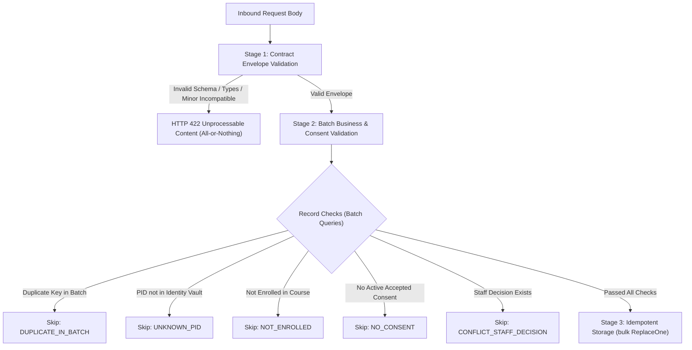

# Feature 23: ML Component Output Ingestion API Specification

This document defines the ingestion contracts, security rules, validation stages, and idempotency guarantees for ML components writing data back into the Learning Management System (LMS) database.

---

## 1. Overview & Endpoints

All endpoints are strictly **POST** routes mounted under `/api/v1/ingest`. Read-back (GET) endpoints for downstream consumers are outside the scope of this feature and will be delivered separately.

| Endpoint | Component Scope | Contract Payload Model | Destination MongoDB Collection |
|---|---|---|---|
| `POST /api/v1/ingest/affective` | `c1` | `AffectiveWeeklyVector` | `affective_weekly` |
| `POST /api/v1/ingest/trajectory` | `c2` | `EngagementTrajectory` | `engagement_trajectories` |
| `POST /api/v1/ingest/risk` | `c3` | `RiskAssessment` | `risk_assessments` |
| `POST /api/v1/ingest/recommendations` | `c4` | `InterventionRecommendation` | `recommendations` |

---

## 2. Authentication & Authorization

### Preshared Secret Key
Component ingestion strictly enforces preshared API key authentication via the `X-Component-Key` HTTP header.

```http
POST /api/v1/ingest/affective HTTP/1.1
Host: lms.institution.edu
Content-Type: application/json
X-Component-Key: <high-entropy-component-secret>
```

### Security Invariants
1. **Header-Only Authentication**: Ingestion endpoints **strictly reject** Admin Bearer JWT tokens. Administrative testing accounts cannot write component predictions.
2. **Timing-Attack Resistance**: Verification uses constant-time string comparison (`hmac.compare_digest`).
3. **Audited Access Violations**: Missing or invalid keys return `401 Unauthorized`. Mismatched component scopes (e.g., submitting a C1 key to the `/risk` endpoint) return `403 Forbidden`. Both violations generate immutable `ACCESS_DENIED` audit events.
4. **Envelope Origin Enforcement**: The request envelope's `source` property must match the authenticated component (`c1`, `c2`, `c3`, or `c4`). If `source != actor.component`, the request is rejected with `403 Forbidden`.
5. **Key Management**: Keys are provisioned by infrastructure administrators via the `COMPONENT_API_KEYS` JSON environment variable:
   ```json
   {"c1": "c1_key_...", "c2": "c2_key_...", "c3": "c3_key_...", "c4": "c4_key_..."}
   ```
   If unconfigured, requests return `503 Service Unavailable`.

---

## 3. Request Envelope & Payload Limits

Incoming payloads must adhere to the Feature 24 standard `Envelope[T]` specification. The `data` property may be a single record object or an array of record objects.

```json
{
  "schema_version": "1.0",
  "generated_at": "2026-10-12T00:00:00Z",
  "source": "c1",
  "request_id": "req_8391dbe25861",
  "data": [ ... ]
}
```

### Request Limits
- **Maximum Batch Size**: `1000` records per request (configured via `INGEST_MAX_BATCH`). Payloads exceeding 1000 items receive `413 Payload Too Large`.
- **Maximum Payload Size**: `5 MB` (`5,242,880` bytes, configured via `INGEST_MAX_BODY_BYTES`). Payloads exceeding this limit receive `413 Payload Too Large`.

---

## 4. Two-Stage Validation Pipeline

Ingestion employs a dual-stage validation gate to ensure data integrity, privacy safety, and student consent compliance:



### Stage 1: Contract Schema Validation (All-or-Nothing)
- Evaluated via `validated_envelope(model)`.
- If any record violates semantic types, bounds (e.g. `modality_contributions` not summing to 1.0, or invalid rank sequences), or contains un-redacted PII patterns, the entire request fails immediately with **HTTP 422**.
- **Privacy Guarantee**: Validation error details format sanitized field paths (`loc`) and standard error messages, **never echoing** raw student input values.

### Stage 2: Batch Business & Consent Validation (Per-Record)
Valid records in the batch proceed; failing records are skipped and reported in the response `rejected_records` array:

| Reason Code | Trigger Condition |
|---|---|
| `DUPLICATE_IN_BATCH` | The same unique key (`(pid, course_id, week_index)` or `recommendation_id`) occurs multiple times in the single submitted batch. The first occurrence is preserved; subsequent duplicates are skipped. |
| `UNKNOWN_PID` | The student PID does not exist in `identity_vault`. |
| `NOT_ENROLLED` | Weekly collections (`affective`, `trajectory`, `risk`): The student has no enrolment document in `enrolments` for the course with status `active`, `completed`, or `withdrawn`. (Not applicable to recommendations). |
| `NO_CONSENT` | The student lacks an active `accepted` decision for the current active consent notice version. **Exemption**: Imported OULAD identities (`is_imported: true` or `source: "oulad"`) are research-exempt. If no active consent notice exists, only OULAD identities are accepted. |
| `CONFLICT_STAFF_DECISION` | Recommendations only: An existing document with that `recommendation_id` already has a staff decision recorded. Any status other than `"proposed"` or `"pending"` (e.g., `"approved"`, `"active"`, `"resolved"`), or an existing outcome entry in `intervention_outcomes`, constitutes a staff decision. |

---

## 5. Idempotency & Storage Semantics

1. **Deterministic Primary Key (`_id`)**:
   - Weekly collections (`affective_weekly`, `engagement_trajectories`, `risk_assessments`):
     $$\text{\_id} = \text{f"}\{\text{pid}\}\_\_\{\text{course\_id}\}\_\_\{\text{week\_index}\}"$$
   - Recommendations collection (`recommendations`):
     $$\text{\_id} = \text{recommendation\_id}$$
2. **Replace-On-Resend**: All persistence operations execute via MongoDB `bulk_write` with `ReplaceOne(..., upsert=True)`.
   - Re-transmitting the same batch replaces matching documents completely without leaving stale attributes.
   - Initial submission reports `created = N, updated = 0`.
   - Subsequent identical re-transmissions report `created = 0, updated = N`.
3. **No Historical Versions**: Only the latest predictions and metrics for each observation window are retained in primary storage collections.
4. **Dry Run**: Submitting query parameter `?dry_run=true` executes all Stage 1 and Stage 2 checks, computes the exact counts that would be created vs updated, writes zero records to domain collections, and records the run with `dry_run: true`.

---

## 6. Run Tracking & Audit Logging

### Ingestion Runs (`ingestion_runs`)
Every request creates an execution record:
- Initial state: `status = "running"`.
- Final state:
  - `status = "completed"`: All submitted records accepted and stored.
  - `status = "partial"`: One or more records rejected at Stage 2.
  - `status = "failed"`: Request aborted due to unexpected error.
- Indexes: `(component, started_at DESC)` and unique `run_id`.

### Audit Logging
- Successful or partial ingestions record an immutable audit entry with action `DATA_INGESTED`.
- Details include execution summary counts (`received`, `accepted`, `rejected`, `created`, `updated`, `dry_run`).
- **Data Exclusion Invariant**: Ingestion audit entries **never** store model output metrics, emotion scores, or predictions.

---

## 7. Sample Request & Response

### Request: `POST /api/v1/ingest/risk`
```json
{
  "schema_version": "1.0",
  "generated_at": "2026-10-12T00:00:00Z",
  "source": "c3",
  "request_id": "req_c3_demo_001",
  "data": [
    {
      "pid": "STU_072f80c3",
      "course_id": "DEMO101",
      "week_index": 2,
      "risk_score": 0.74,
      "risk_tier": "high",
      "modality_contributions": {
        "affective": 0.40,
        "behavioral": 0.35,
        "academic": 0.25
      },
      "top_drivers": [
        "escalating_exam_anxiety",
        "drop_in_portal_sessions"
      ]
    }
  ]
}
```

### Response: `HTTP 200 OK`
```json
{
  "run_id": "run_93a1cf02b9e44d5c97b82f01a3",
  "schema_version": "1.0",
  "dry_run": false,
  "received": 1,
  "accepted": 1,
  "rejected": 0,
  "created": 1,
  "updated": 0,
  "rejected_records": []
}
```

---

## 8. Pipeline Orchestration & Scheduling

For details on automated weekly scheduling, readiness polling (`GET /api/v1/pipeline/ready`), HMAC-signed webhook dispatches, and stage coverage progression, refer to [docs/PIPELINE.md](file:///d:/4Y%201S/LMS/emotion-aware-student-early-warning-system/docs/PIPELINE.md).

