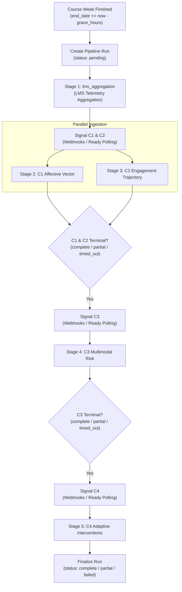

# Feature 22: Weekly Pipeline Orchestrator & Scheduler

This document specifies the architecture, stage progression state machine, distributed leasing mechanism, configuration parameters, and APIs for the LMS Weekly Pipeline Orchestrator.

---

## 1. Overview & Architecture

The weekly pipeline orchestrator coordinates longitudinal processing across finished course weeks. It bridges LMS activity telemetry to the four downstream ML analytics components:
- **LMS Aggregation (Feature 20)**: Aggregates daily telemetry events into longitudinal records (`behavior_weekly`).
- **Component 1 (Affective State Detection)**: Derives emotional distress vectors from forum/chat messages (`affective_weekly`).
- **Component 2 (Engagement Trajectory)**: Identifies longitudinal trends in LMS behavior (`engagement_trajectories`).
- **Component 3 (Multimodal Risk Assessment)**: Combines affective vectors, trajectories, and continuous academic metrics to classify student risk (`risk_assessments`).
- **Component 4 (Adaptive Interventions)**: Generates actionable recommendations for students identified at or above disengagement thresholds (`recommendations`).

The orchestrator manages stage readiness, tracks student coverage thresholds, dispatches HMAC-signed webhooks, exposes polling endpoints, and logs immutable Feature 7 audit events without ever leaking student PII.



---

## 2. Stage State Machine & Lifecycle

Each pipeline run is tracked in MongoDB collection `pipeline_runs` under an idempotent document identified by `pipe_{course_id}_{week_index}`.

### Stage Statuses

| Status | Meaning |
|---|---|
| `waiting` | Prerequisite stages are not yet complete. |
| `ready` | Prerequisites met; downstream component notified to begin execution. |
| `receiving` | Component has written partial results (at least 1 student received), but coverage threshold is not yet met. |
| `complete` | Stage reached coverage threshold ($\ge 90\%$) or C4 had 0 eligible students. |
| `partial` | Stage timed out after `PIPELINE_STAGE_TIMEOUT_HOURS` with partial results received ($> 0$). |
| `timed_out` | Stage timed out after `PIPELINE_STAGE_TIMEOUT_HOURS` with zero results received. |
| `failed` | Handler threw an unhandled exception (e.g. `lms_aggregation`). |
| `skipped` | Handler was skipped or omitted by explicit configuration. |

### Overall Pipeline Run Statuses

- **`pending`**: Initial state upon discovery.
- **`running`**: In progress; at least one stage is active.
- **`complete`**: All stages reached `complete` or `skipped`.
- **`partial`**: All stages reached terminal state, but one or more timed out or completed partially.
- **`failed`**: Core LMS aggregation failed or all stages failed.

---

## 3. Distributed Lock Architecture

To prevent split-brain execution across multiple worker replicas or auto-scaling containers, the orchestrator acquires an atomic lease lock in `scheduler_locks`:
- **Lock Key**: `pipeline_tick`
- **Lease Duration**: 300 seconds (5 minutes)
- **Takeover Rule**: If the worker holding the lease crashes or hangs past `expires_at`, any worker can take over the lease atomically.
- **Release**: Explicit release upon tick completion via `release_lock`.

---

## 4. Configuration Reference

All settings can be configured via environment variables or `.env`:

| Setting | Default | Description |
|---|---|---|
| `SCHEDULER_ENABLED` | `false` | Master toggle for background scheduler. Inactive by default. |
| `SCHEDULER_TICK_MINUTES` | `15` | Polling interval between orchestrator tick evaluations. |
| `SCHEDULER_GRACE_HOURS` | `1` | Grace period after week `end_date` before processing starts. |
| `SCHEDULER_LOOKBACK_WEEKS` | `2` | Maximum historical age of finished weeks to pick up. |
| `SCHEDULER_MAX_WEEKS_PER_TICK` | `20` | Maximum candidate weeks processed in a single tick. |
| `SCHEDULER_EXCLUDED_COURSE_SOURCES` | `oulad,demo` | Course sources excluded from automated scheduling. |
| `PIPELINE_COVERAGE_THRESHOLD` | `0.9` | Fraction of eligible students required for stage completion. |
| `PIPELINE_STAGE_TIMEOUT_HOURS` | `24` | Maximum hours a stage can wait in `ready`/`receiving`. |
| `PIPELINE_C4_MIN_TIER` | `medium` | Minimum risk tier qualifying students for C4 interventions (`medium`, `high`, `critical`). |
| `COMPONENT_WEBHOOKS` | `"{}"` | JSON mapping of component names to webhook URLs. |
| `WEBHOOK_SIGNING_SECRET` | `""` | Shared HMAC-SHA256 secret for webhook verification. |
| `WEBHOOK_TIMEOUT_SECONDS` | `5.0` | Timeout per HTTP webhook dispatch attempt. |
| `WEBHOOK_MAX_RETRIES` | `3` | Maximum retry attempts with exponential backoff. |

---

## 5. Webhooks & Polling Contract

Downstream ML components can consume stage ready events via either push webhooks or pull polling.

### Push Webhooks (HMAC-SHA256)
When a stage transitions to `ready`, the orchestrator dispatches an HTTP POST request to the component's configured webhook URL:

```http
POST /webhook/lms-events HTTP/1.1
Host: ml-c1.internal.edu
Content-Type: application/json
X-LMS-Timestamp: 2026-10-12T00:00:00+00:00
X-LMS-Signature: sha256=a1b2c3d4e5f6...
```

**Signature Calculation**:
$$\text{Signature} = \text{HMAC-SHA256}(\text{Secret}, \text{Timestamp} + "." + \text{RawBody})$$

**Event Payload Schema**:
```json
{
  "event": "stage_ready",
  "component": "c1",
  "course_id": "CS101",
  "week_index": 2,
  "run_id": "run_CS101_w2_9a8b7c6d",
  "schema_version": 1,
  "generated_at": "2026-10-12T00:00:00+00:00"
}
```

### Pull Polling (`GET /api/v1/pipeline/ready`)
Components can periodically poll the LMS for course weeks awaiting processing:

```http
GET /api/v1/pipeline/ready?component=c1 HTTP/1.1
Host: lms.institution.edu
X-Component-Key: <component-secret-key>
```

**Response (`200 OK`)**:
```json
{
  "component": "c1",
  "count": 1,
  "items": [
    {
      "course_id": "CS101",
      "week_index": 2,
      "run_id": "run_CS101_w2_9a8b7c6d",
      "stage": "c1",
      "status": "ready",
      "since": "2026-10-12T00:00:00+00:00",
      "eligible": 150,
      "received": 0,
      "coverage": 0.0,
      "notified_at": "2026-10-12T00:00:00+00:00"
    }
  ]
}
```

---

## 6. Management & Observability Endpoints

All admin endpoints are secured with Bearer JWT tokens requiring `admin` or `auditor` roles.

| Method | Path | Required Role | Description |
|---|---|---|---|
| `GET` | `/api/v1/pipeline/ready` | Component Key or Admin | Poll for ready stages. |
| `GET` | `/api/v1/pipeline/runs` | Admin / Auditor | List and filter pipeline runs with pagination. |
| `GET` | `/api/v1/pipeline/runs/{course_id}/{week_index}` | Admin / Auditor | Retrieve specific run stage breakdown. |
| `POST` | `/api/v1/pipeline/trigger` | Admin | Manually trigger or reset a course week run. |
| `POST` | `/api/v1/pipeline/runs/{course_id}/{week_index}/advance` | Admin | Manually advance an active run. |
| `GET` | `/api/v1/pipeline/status` | Admin / Auditor | Scheduler runtime heartbeat and diagnostics. |

---

## 7. Privacy & Audit Compliance

1. **Zero PII Invariant**: Webhooks, poll endpoints, CLI logs, and audit records never contain student identities, emails, names, or individual PIDs. Only aggregate counts and percentages are transferred.
2. **Consent Gating**: Eligible student sets strictly filter out students without active accepted consent (Feature 6), exempting public OULAD research cohorts.
3. **Immutable Auditing**: Every run creation, manual trigger, run start, and run completion records a structured Feature 7 audit entry (`PIPELINE_TRIGGERED`, `PIPELINE_RUN_STARTED`, `PIPELINE_RUN_FINISHED`).
